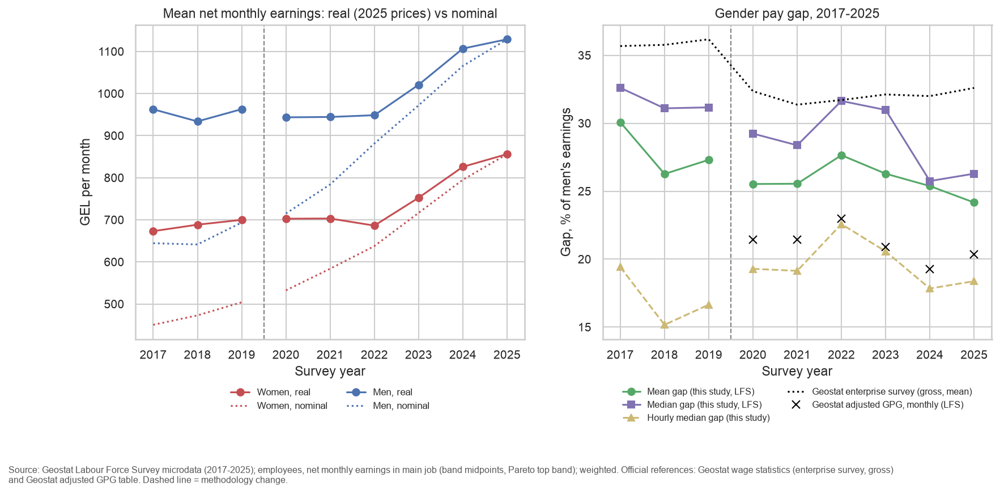
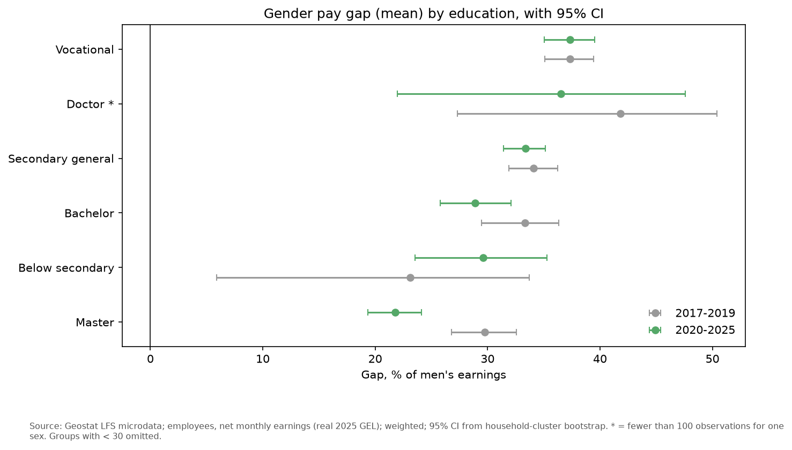
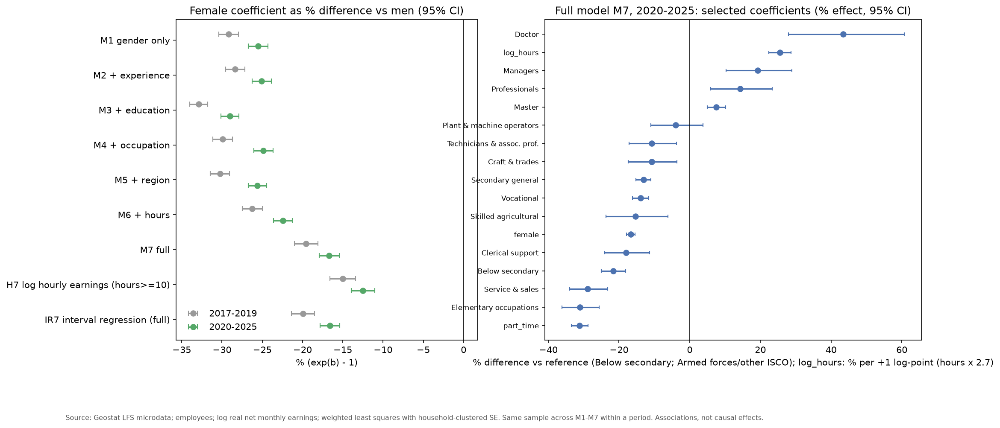
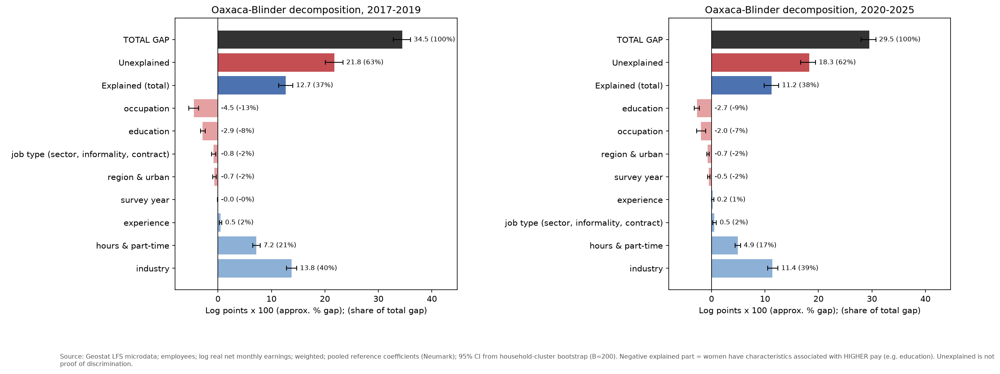
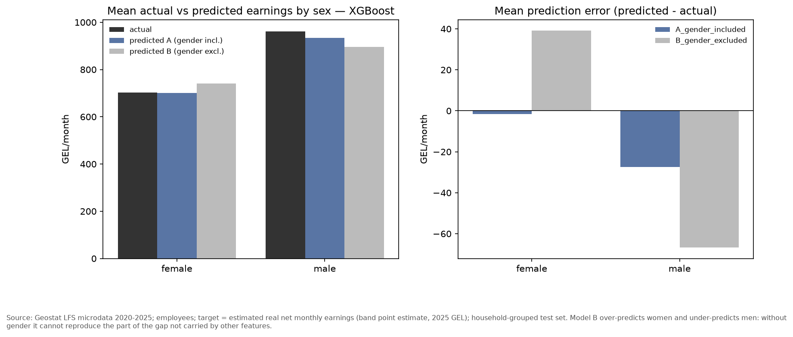

# სქესი და შემოსავალი საქართველოში, 2017–2025
## Georgia Income Analytics — საბოლოო კვლევითი ანგარიში (Stage 07)
**თარიღი:** 2026-11-28 · **მონაცემები:** საქსტატი, სამუშაო ძალის კვლევის (LFS) და შინამეურნეობების შემოსავლებისა
და ხარჯების კვლევის (HIES) საჯარო მიკრომონაცემები · **გამეორებადობა:** 335 ავტომატური ტესტი, ყველა გადის

---

## შეჯამება
**საკვლევი კითხვა:** აქვთ თუ არა საქართველოში ქალებს საშუალოდ უფრო დაბალი შემოსავალი, ვიდრე კაცებს; თუ კი —
რამდენით და რა ფაქტორები უკავშირდება ამ სხვაობას?

**პასუხი:**
- **დიახ.** 2020–2025 წლებში დაქირავებით დასაქმებული ქალების ხელზე ასაღები თვიური ხელფასი კაცებისაზე საშუალოდ
  **25.5%-ით** [95% CI 24.2–26.7] და მედიანით **28.8%-ით** [27.4–29.8] დაბალია — დაახლოებით **258 ₾ თვეში**
  (2025 წლის ფასებში). 2017–2019 წლებში: 27.9% და 31.8%. სხვაობა სტატისტიკურად მნიშვნელოვანია ყველა ტესტით
  (p < 10⁻²⁰⁰, Benjamini–Hochberg კორექციის შემდეგაც) და პრაქტიკულადაც არსებითია (Cohen's d ≈ 0.46).
- სხვაობა არსებობს **ყველა** ასაკობრივ ჯგუფში, განათლების დონეზე, 11-ივე რეგიონში და თითქმის ყველა პროფესიაში;
  პროფესია × რეგიონის 85 ჯგუფიდან 84-ში ქალების საშუალო ხელფასი ნაკლებია.
- **საათობრივი** მედიანური სხვაობა 18.9%-ია — თვიური სხვაობის დაახლოებით მესამედი ნაკლები სამუშაო საათებს უკავშირდება.
- **ტოლი დაკვირვებადი მახასიათებლების** (განათლება, გამოცდილება, პროფესია, დარგი, რეგიონი, საათები, სამუშაოს ტიპი, წელი)
  პირობებში სხვაობა **~17%** რჩება (2020–25; 2017–19: ~20%). ეს ემთხვევა საქსტატის ოფიციალურ კორექტირებულ სხვაობას
  (19–23%) და ML მოდელის დამოუკიდებელ შეფასებას (16.2%).
- Oaxaca–Blinder დეკომპოზიციით სხვაობის **~38%** აიხსნება დაკვირვებადი ფაქტორებით — ძირითადად **დარგობრივი
  განაწილებით** (ქალები ჭარბობენ დაბალანაზღაურებად დარგებში) და **ნაკლები საათებით**; **განათლება და პროფესია სხვაობას
  ამცირებს** — დასაქმებული ქალები უფრო განათლებულები არიან. **~62% აუხსნელია**, რაც **არ ნიშნავს** დისკრიმინაციას —
  მასში შედის ყველაფერი, რაც მონაცემებში არ არის (სტაჟი, დეკრეტული შესვენებები, საწარმო, თანამდებობა).
- სხვაობა 2017–2025 წლებში **ნელა მცირდება** (30% → 24%), ქალების რეალური ხელფასი უფრო სწრაფად იზრდება (+27% vs +17%),
  თუმცა 2020 წლის მეთოდოლოგიური წყვეტის გამო კლება ფორმალურად არ არის დამტკიცებული.

---

## 1. კვლევის კითხვა და ჰიპოთეზები
| | H0 | შედეგი |
|---|---|---|
| H1 | ქალებისა და კაცების საშუალო შემოსავალი ტოლია | უარყოფილია |
| H2 | ასაკის გათვალისწინებით სხვაობა არ არის | უარყოფილია (25.1%) |
| H3 | განათლების გათვალისწინებით სხვაობა არ არის | უარყოფილია (**29.4%** — იზრდება) |
| H4 | ერთსა და იმავე პროფესიულ ჯგუფში სხვაობა არ არის | უარყოფილია (25.7%) |
| H5 | რეგიონებს შორის შემოსავალი არ განსხვავდება | უარყოფილია (ეფექტი მცირე, η² 0.046) |
| H6–H7 | ასაკობრივ / განათლების ჯგუფებს შორის არ განსხვავდება | უარყოფილია (η² 0.027 / 0.079) |
| H8 | სქესი და შრომის ბაზრის კატეგორია დამოუკიდებელია | უარყოფილია (პროფესიული სეგრეგაცია: Cramér's V 0.40) |
ყველა ტესტი ორმხრივია, α = 0.05, 2020–2025 წლების მონაცემებით (2017–19 — იგივე დასკვნები).

## 2. მონაცემები
| წყარო | წლები | ერთეული | მოცულობა | გამოყენება |
|---|---|---|---|---|
| **LFS** მიკრომონაცემები | 2017–2025 | პირი 15+ | 529,043 ჩანაწერი; ვალიდური ხელფასით დაქირავებული: 40,141 (2017–19) + 81,166 (2020–25) | **ძირითადი** — ინდივიდუალური ხელფასი |
| **HIES** მიკრომონაცემები | 2017–2025 | ოჯახი | 116,727 ოჯახი, 388,098 წევრი | დამხმარე — **მხოლოდ საოჯახო** შემოსავალი |
| საქსტატის ხელფასების ცხრილები | 2014–2025 | აგრეგატი | ოფიციალური კორექტირებული სხვაობა, საწარმოთა ხელფასები | ვალიდაცია |
| CPI (2010=100) | 2000–2026 | თვიური | — | დეფლაცია 2025 ფასებში |

ყველა 34 ფაილი ოფიციალური წყაროდანაა (`geostat.ge/media`), ჩამოტვირთვა ლოგირებულია, SHA-256-ით დაცულია და
ორიგინალი უცვლელია (ტესტი).

**შემოსავლის განმარტება:** ხელზე ასაღები (net) ხელფასი ძირითადი სამუშაოდან, ბოლო ნამუშევარი თვე, ₾, მხოლოდ
**დაქირავებულები**. საჯარო ფაილში ქვეყნდება **ინტერვალებით** (9 ინტერვალი 2017–19, 12 — 2020–25) → თანხა
შეფასებულია ინტერვალის შუა წერტილით (ზედა ღია ინტერვალში — Pareto, α = 2.5–4.2), მედიანა — ინტერვალის შიგნით
ინტერპოლაციით, რეალური ₾ — CPI-ით (`real = nominal × CPI̅₂₀₂₅ / CPI̅_წელი`).

**რაც საჯაროდ არ არსებობს:** ზუსტი ხელფასი; ინდივიდუალური შემოსავალი HIES-ში; შერჩევის strata/PSU; სამუშაო სტაჟი;
თვითდასაქმებულთა ხელფასი. **საოჯახო შემოსავალი ინდივიდუალურად არ ჩათვლილა.**

## 3. მეთოდოლოგია (ეტაპები)
| ეტაპი | რა გაკეთდა |
|---|---|
| 00 Feasibility | წყაროების მოძიება; დადგინდა, რომ ინდივიდუალური ხელფასი მხოლოდ LFS-შია (ინტერვალებით) |
| 01 Data Collection | 34 ფაილი, ჩამოტვირთვის ლოგი, manifest, Data Dictionary (LFS 307, HIES 205 ცვლადი), სანდოობის შემოწმებები |
| 02 Cleaning & DB | SQLite ბაზა (`individuals`, `income`, `households`, `household_income`…), 510-რიგიანი ცვლადების mapping, არცერთი ჩანაწერი არ წაშლილა (flag + ლოგი, 337 ჩანაწერი), CPI, Pareto |
| 03 EDA | შეწონილი/შეუწონავი სტატისტიკა, 14 გრაფიკი, ჯგუფური ანალიზი |
| 04 Statistics | Welch t, Mann–Whitney, ANOVA/Kruskal–Wallis, χ² + **შერჩევაზე მორგებული** ტესტები (წონა + ოჯახზე კლასტერიზებული SE), cluster bootstrap CI, BH, რეგრესიის „კიბე", ინტერვალური რეგრესია, Oaxaca–Blinder |
| 05 ML | 5 ალგორითმი × (სქესით / სქესის გარეშე), ოჯახების მიხედვით დაყოფა, CV-ძებნა, SHAP, fairness |
| 06 Dashboard | Streamlit, ცოცხალი გამოთვლები, მცირე შერჩევის დაცვა |

**ძირითადი პრინციპები:** (1) LFS-ის ორი მეთოდოლოგიური პერიოდი (2017–19 / 2020–25, ILO 13th → 19th/20th ICLS)
**არასდროს ერთიანდება**; (2) ყველა შეფასება შეწონილია; (3) ერთი ოჯახი LFS-ში რამდენჯერმე ჩანს → სტანდარტული
შეცდომები და ML-დაყოფა ოჯახების მიხედვით (naive ტესტები სიზუსტეს ~3-ჯერ აჭარბებს); (4) მცირე ჯგუფებზე
(<30 / <100 დაკვირვება) დასკვნა არ კეთდება; (5) შედეგები აღწერითი/კორელაციურია.

## 4. შედეგები
### 4.1 დაუკორექტირებელი სხვაობა
| | 2017–2019 | 2020–2025 |
|---|---|---|
| ქალი / კაცი, საშუალო (₾, 2025 ფასები) | 687 / 953 | 756 / 1,014 |
| ქალი / კაცი, მედიანა | 556 / 816 | 637 / 895 |
| **საშუალოს სხვაობა** | **27.9%** [26.4; 29.3] | **25.5%** [24.2; 26.7] |
| **მედიანის სხვაობა** | **31.8%** [30.7; 32.9] | **28.8%** [27.4; 29.8] |
| **საათობრივი მედიანის სხვაობა** | **17.1%** [15.5; 18.4] | **18.9%** [17.5; 20.2] |
| Cohen's d (log) / rank-biserial | 0.51 / 0.31 | 0.46 / 0.28 |

**წლების მიხედვით** (საშუალოს სხვაობა, 95% CI): 2017 30.1% [26.9; 33.1] · 2018 26.3% · 2019 27.3% ‖ 2020 25.5%
[22.8; 28.1] · 2021 25.5% · 2022 27.6% · 2023 26.3% · 2024 25.4% · 2025 **24.2%** [21.8; 26.4].
2025 წელს ნომინალურად: ქალი 856 ₾, კაცი 1,129 ₾ (მედიანა 751 / 1,019 ₾).



### 4.2 სად არის სხვაობა (2020–2025)
- **ასაკი:** უდიდესი 35–44 წ. (28.8%), უმცირესი 18–24 წ. (18.7%).
- **განათლება:** პროფესიული 37.4%, ზოგადი საშუალო 33.4%, ბაკალავრი 28.9%, დოქტორი 36.5%, **მაგისტრი 21.8%** (უმცირესი);
  მაღალი განათლება სხვაობას ერთმნიშვნელოვნად არ ამცირებს.
- **რეგიონი:** აჭარა 30.5% (უდიდესი) … თბილისი 24.9% … კახეთი 21.4%; რაჭა-ლეჩხუმი 11.3% [5.7; 16.6] — ძირითადად კაცების
  დაბალი ხელფასის გამო.
- **პროფესია:** ტექნიკოსები 38.0%, ოპერატორები 37.1%, ხელოსნები 35.8%; მომსახურება/ვაჭრობა 15.6%, საოფისე 19.8%,
  მენეჯერები 19.9%.
- **დარგი:** განათლებაში, მშენებლობასა და ენერგეტიკაში სხვაობა ~0; ჯანდაცვაში 33%, ფინანსებში 27%.
- **სამუშაო საათები:** ქალები კვირაში 38–40, კაცები 45–48 საათს მუშაობენ; სრულ განაკვეთზე სხვაობა 25%,
  არასრულზე 9%.
- **განაწილება:** ქალები შეადგენენ ქვედა 20%-ის 66%-ს და ზედა 20%-ის 35%-ს.



### 4.3 კორექტირებული სხვაობა (რეგრესია; „ქალი" → % = exp(b) − 1)
| მოდელი | 2017–2019 | 2020–2025 |
|---|---|---|
| მხოლოდ სქესი | −29.2% | −25.5% |
| + გამოცდილება | −28.4% | −25.1% |
| + განათლება | −32.9% | −29.0% |
| + პროფესია | −29.9% | −24.9% |
| + რეგიონი | −30.3% | −25.6% |
| + საათები | −26.3% | −22.4% |
| **სრული** (+ დარგი, სექტორი, არაფორმალურობა, კონტრაქტი, წელი) | **−19.6%** [−21.0; −18.1] | **−16.7%** [−17.9; −15.4] |
| ინტერვალური რეგრესია (სრული) | −20.0% | −16.6% |
| საათობრივი ხელფასი (სრული) | −15.0% | −12.5% |
R² (სრული) 0.41–0.42; GVIF ≤ 1.85; ჰეტეროსკედასტურობა → robust SE.



### 4.4 Oaxaca–Blinder დეკომპოზიცია (log, pooled მითითება)
| | 2017–2019 | 2020–2025 |
|---|---|---|
| სრული სხვაობა (log × 100) | 34.5 | 29.5 |
| **ახსნილი** | **37%** | **38%** [33–43%] |
| — დარგი | +40% | +39% |
| — საათები, არასრული განაკვეთი | +21% | +17% |
| — განათლება | −8% | −9% |
| — პროფესია | −13% | −7% |
| **აუხსნელი** | **63%** | **62%** |
მითითების არჩევისადმი მგრძნობელობა: ახსნილი ნაწილი 18–48%.



### 4.5 Machine Learning
- საუკეთესო **XGBoost**: test MAE 272 ₾, R² 0.455 (log-ზე 0.55); წრფივი მოდელი: MAE 320, R² 0.32. Learning curve:
  მეტი მონაცემი შედეგს არ გააუმჯობესებს — ზღვარს ინტერვალური გაზომვა და ცვლადების ნაკლებობა ქმნის.
- **სქესით ყველა მოდელი უკეთესია** (MAE −5…6 ₾). **სქესის გარეშე** მოდელი ქალებს +39 ₾-ით აჭარბებს, კაცებს −67 ₾-ით
  ამცირებს; სქესის ინფორმაცია სხვა ცვლადებშია (ROC AUC 0.89).
- ტოლი მახასიათებლებით „სქესის შეცვლა" მოდელში: **16.2%** — Stage 04-ის რეგრესიის 16.7%-ის დამოუკიდებელი დადასტურება.
- უმნიშვნელოვანესი ფაქტორები: დარგი, პროფესია, წელი, საათები, სქესი, განათლება, რეგიონი.
- ფარდობითი სიზუსტე ქალებისა და კაცებისთვის ტოლია (MAE ≈ 33% საშუალო ხელფასისა).



### 4.6 საოჯახო შემოსავალი (HIES, ცალკე)
ქალისა და კაცის მეთაურობით ოჯახებში ერთ სულზე შემოსავალი თითქმის ტოლია (−6%…+3%); ქალის მეთაურობით ოჯახები
უფრო მცირეა. ეს **ოჯახის** მაჩვენებელია — ინდივიდუალურ ხელფასთან არ შედარდება და მას არ ეწინააღმდეგება.

### 4.7 ოფიციალურ სტატისტიკასთან შედარება
| საზომი | ეს კვლევა | საქსტატი |
|---|---|---|
| ნედლი სხვაობა (საშუალო) | 24–28% (net, LFS) | 31–36% (gross, საწარმოთა კვლევა — სხვა წყარო) |
| კორექტირებული სხვაობა (თვიური) | 17–20% | 19–23% (LFS) |
| CPI-ის წლიური ინფლაცია | — | ემთხვევა ±0.1 პ.პ. (ტესტი) |

## 5. შედეგების სანდოობა — დამოუკიდებელი შემოწმებები
| შემოწმება | შედეგი |
|---|---|
| Bootstrap vs delta-method CI | 2020–25: [24.2; 26.7] vs [24.2; 26.8] |
| ინტერვალური რეგრესია vs შუა წერტილი (OLS) | −16.6% vs −16.7% |
| Oaxaca აუხსნელი vs რეგრესიის კოეფიციენტი | ზუსტი ტოლობა (0.183) |
| Oaxaca vs `statsmodels` OaxacaBlinder | ემთხვევა 10⁻⁸ სიზუსტით |
| ML gender flip vs რეგრესია | 16.2% vs 16.7% |
| Dashboard vs Stage 03 | 756 / 1,014 ₾, 25.5% — ემთხვევა |
| შეწონილი vs შეუწონავი სხვაობა | 25.5% vs 26.0% |
| 2017–19 რეპლიკაცია | ყველა დასკვნა იგივეა |
| ავტომატური ტესტები | **335/335** (Stage 00: 54, 01: 92, 02: 103, 03: 28, 04: 24, 05: 18, 06: 16) |

## 6. შეზღუდვები
1. **ინტერვალური ხელფასი** — ზუსტი თანხა უცნობია; შეფასება შუა წერტილით/Pareto-თი; ინტერვალური რეგრესია იგივეს აჩვენებს.
2. **მხოლოდ დაქირავებულები** — თვითდასაქმებულები და დაუსაქმებლები არ შედიან; შერჩევის მიკერძოება (ვინ მუშაობს) არ არის კორექტირებული (Heckman).
3. **Non-response** იზრდება (6.8% 2017 → 23.2% 2025; კაცებში მეტი); წონები ამას არ ასწორებს.
4. **შერჩევის სრული დიზაინი** (strata/PSU) არ ქვეყნდება → SE მიახლოებითია; 2017–19-ში ოჯახი მხოლოდ კვარტალში იდენტიფიცირდება.
5. **დაუკვირვებელი ფაქტორები:** ფაქტობრივი სტაჟი, კარიერის შესვენებები, საწარმო, თანამდებობა, ოჯახური ვალდებულებები.
6. **„ცუდი კონტროლი":** პროფესია, დარგი, საათები შეიძლება თავად სქესთან დაკავშირებული უთანასწორობის შედეგი იყოს — მათი
   კონტროლი სხვაობის ნაწილს „ხსნის", თუმცა ის შეიძლება უთანასწორობის ნაწილი იყოს.
7. **2020 წლის მეთოდოლოგიური წყვეტა** — პერიოდები პირდაპირ არ შედარდება.
8. მცირე ჯგუფები (15–17 წ., უმაღლესი პროფესიული, შეიარაღებული ძალები, სოფ. მეურნეობის მუშაკები) — დასკვნა არ კეთდება.
9. ML მოდელი ახალ წლებზე სუსტად გადადის (2024–25-ზე −140 ₾) — ყოველწლიური განახლება საჭიროა.

## 7. დასკვნები
1. **სხვაობა არსებობს და დიდია:** დაქირავებული ქალები კაცებზე ~25% (საშუალო) / ~29% (მედიანა) ნაკლებს იღებენ —
   სტატისტიკურად მნიშვნელოვნად, პრაქტიკულად არსებითად, ყველა ჯგუფში.
2. **ნაწილობრივ აიხსნება:** ~38% — დარგობრივი სეგრეგაცია და ნაკლები სამუშაო საათები; ქალების უპირატესობა განათლებასა და
   პროფესიულ ჯგუფში სხვაობას **ამცირებს**, ანუ განათლება სხვაობას ვერ ხსნის.
3. **ტოლი დაკვირვებადი მახასიათებლებით ~17% რჩება** — სამი დამოუკიდებელი მეთოდით (რეგრესია, ინტერვალური რეგრესია, ML)
   და საქსტატის ოფიციალურ შეფასებასთან თანხვედრით.
4. **ნელა მცირდება** (30% → 24%, 2017–2025), მაგრამ მეთოდოლოგიური წყვეტის გამო ეს ტენდენცია ფორმალურად არ დასტურდება.
5. **რისი დამტკიცება არ შეგვიძლია:** რომ აუხსნელი ~17% / ~62% დისკრიმინაციაა; რომ რომელიმე ფაქტორი სხვაობის მიზეზია;
   რას მიიღებდნენ ამჟამად დაუსაქმებელი ქალები; თვითდასაქმებულთა სხვაობა.

## 8. რეკომენდაციები შემდგომი კვლევისთვის
- საქსტატისგან **კონფიდენციალური წვდომის** მოთხოვნა: ზუსტი ხელფასი (B17/B24), strata/PSU, 2017–19 ოჯახის მუდმივი ID.
- Non-response-ის კორექცია (inverse probability weighting) და შერჩევის მოდელი (Heckman) დასაქმებაზე.
- სამუშაო სტაჟისა და კარიერის შესვენებების საზომი (მაგ. ცალკე მოდული) — „აუხსნელი" ნაწილის შესამცირებლად.
- საწარმოს დონის მონაცემები (ერთსა და იმავე საწარმოში ქალი–კაცის შედარება).
- ანალიზის ყოველწლიური განახლება (pipeline სრულად ავტომატიზებულია).

## 9. გამეორებადობა
```bash
cd ~/Desktop/Georgia-Income-Analytics
python3 -m venv .venv && .venv/bin/pip install -r requirements.txt
.venv/bin/python src/data_collection.py            # ოფიციალური ფაილების ჩამოტვირთვა
cd src                                             # შემდეგ README-ში ჩამოთვლილი სკრიპტები თანმიმდევრობით
cd .. && .venv/bin/python -m pytest -q tests       # 335 ტესტი
.venv/bin/streamlit run dashboard/app.py           # Dashboard
```
ეტაპების ანგარიშები: `reports/stage00_feasibility_report.md`, `stage_01_report.md` … `stage_06_report.md`.
Notebooks: `notebooks/03`, `04`, `05` (შესრულებული). მოდელი: `models/best_income_model.joblib`.

## 10. გამჭვირვალობა — კვლევის მსვლელობისას ნაპოვნი და გასწორებული შეცდომები
| ეტაპი | შეცდომა | გასწორება |
|---|---|---|
| 00 | პროფესიის კლასიფიკაცია ყველა წლისთვის ISCO-08-ად იყო აღწერილი | 2017–19-ში ISCO-88 (Stage 01) |
| 01 | gzip-ით მიწოდებული HTML-ის ზომის შემოწმება ცრუ შეცდომას იძლეოდა | ზომა იზომება გადაცემულ ბაიტებზე |
| 02 | HIES-ში უარყოფითი „საჩუქარი" თავიდან „ზარალად" იყო ახსნილი | შეუძლებელ მნიშვნელობად მოინიშნა |
| 03 | ინტერვალური მონაცემის მედიანა ნახტომებით იცვლებოდა (0–44%) | ინტერვალის შიგნით ინტერპოლაცია |
| 03 | რეგიონების გრაფიკის ლეგენდა პერიოდებს ურევდა | ლეგენდა სვეტების მიხედვით |
| 03 | საშუალო საათობრივი სხვაობა (3–13%) არასანდო აღმოჩნდა | ძირითადად მედიანა (~19%) |
| 04 | არაფორმალურობა ≡ სოფ. მეურნეობა (სრული კოლინეარობა) | 0/1 ინდიკატორი + დარგი |
| 04 | ინტერვალური რეგრესიის კოეფიციენტი პოზიციით იკითხებოდა → მცდარი შუალედური დასკვნა | სახელით + ტესტი |
| 04 | χ²-ს არ ჰქონდა შერჩევაზე მორგებული ვერსია | დიზაინზე დაფუძნებული Wald ტესტი |
| 05 | Random Forest სისტემატურად ამცირებდა პროგნოზს (−38 ₾) | საუკეთესოდ არ შეირჩა; აღწერილია |
| 05 | PDP-ის ინტერპრეტაცია (ასაკი, საათები) გრაფიკს არ ემთხვეოდა | შესწორდა გრაფიკის მიხედვით |
| 06 | მედიანა „ზრდის" ისრით ჩანდა | ჩვეულებრივი ტექსტი |

---
*წყარო: საქართველოს სტატისტიკის ეროვნული სამსახური (საქსტატი), www.geostat.ge. ანალიზი — აღწერითი და კორელაციური;
მიზეზშედეგობრივი დასკვნები არ კეთდება.*
